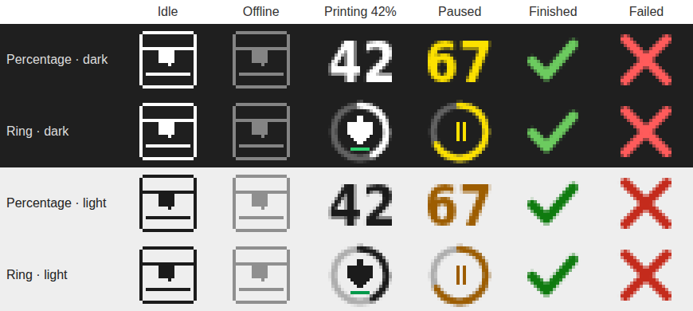
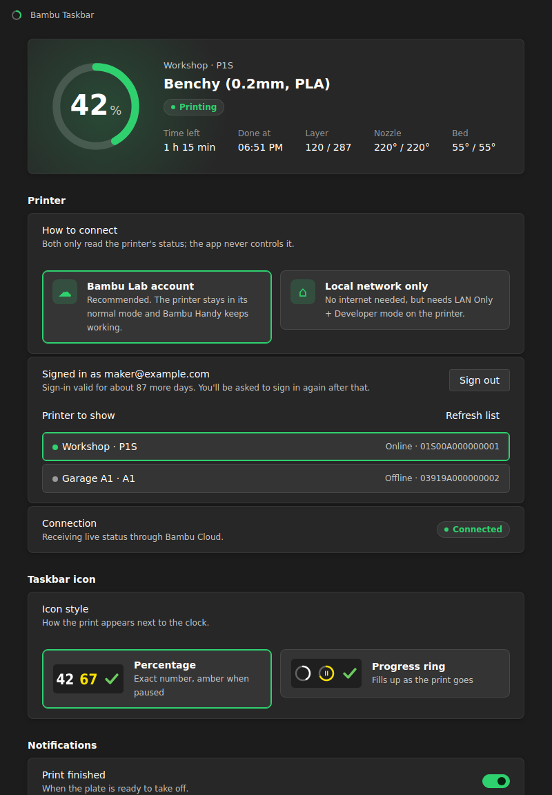
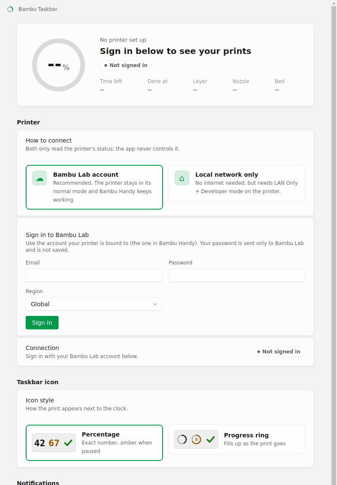

# bambu-taskbar

A Windows tray icon that shows the progress of your Bambu Lab 3D print next to the clock: the percentage, time
left, and a notification when the print finishes or needs attention. Sign in with your Bambu Lab account and it
works with the printer exactly as it is (Bambu Handy keeps working), or connect directly over your local
network if you prefer. Bambu Studio doesn't need to be running.



## Features

- **Tray icon** showing the percentage, or a progress ring around a nozzle laying down a line of filament. It turns amber when paused, shows a green tick when
  finished and a red cross when failed, and shows a printer outline when idle or offline. Icons are sharp at
  every display scaling and follow the taskbar's light or dark mode.
- **Tooltip and menu** with the file name, percentage, layer, time left and the clock time it will be done.
- **Notifications:** print finished, almost done (N minutes left), paused (filament ran out, a problem detected,
  or paused by hand), failed (with the printer's error code) and, optionally, started.
- **Settings window** with a live print card (progress, time left, layer, nozzle and bed temperatures), printer
  discovery on your network, and the notification settings.
- **Two ways to connect:** your Bambu Lab account (cloud, the default) or the local network (LAN). Both only
  *read* status. The app never sends print or control commands.
- **Secure by default:** TLS is always verified. Sign in on Bambu's own page (Google and Apple work) or with a
  Bambu password; the password is never stored; only the sign-in token is
  kept, encrypted with Windows DPAPI. In LAN mode the printer's certificate is checked against Bambu Lab's CA
  and its serial number, and the access code is encrypted the same way.

| Dark | Light |
|:-:|:-:|
|  |  |

## Set up

### Bambu Lab account (recommended)

1. Open Bambu Taskbar. The settings window opens on first start.
2. Under **Printer**, keep **Bambu Lab account** selected. Choose **China** as the region only if your account is on
   bambulab.cn.
3. Click **Sign in with Google, Apple or email…**. Bambu Lab's own sign-in page opens in a window; sign in the way
   you do in Bambu Handy / Bambu Studio (Google, Apple, or email and password). The window closes by itself.
   - Or type your Bambu email and password straight into Settings. If Bambu emails you a verification code, or
     your account uses an authenticator app, enter that code.
4. Pick your printer from the list. If you only have one, it is picked for you.

That's it. Nothing changes on the printer. Bambu sign-ins last about three months; when yours expires you get a
notification and sign in again in Settings.

### Local network mode (optional)

Use this if you'd rather not go through Bambu's cloud. Third-party apps can only connect locally when the
printer is in **LAN Only mode** with **Developer mode** turned on, which disconnects it from the cloud, so
**Bambu Handy stops working**. On the printer's screen:

| Model | LAN Only mode and access code |
|---|---|
| A1, A1 mini, P1P, P1S | **Settings → WLAN** (or **Network**) → **LAN-only Mode** |
| X1, X1C, X1E, H2D, P2 | **Settings → LAN Mode** |

1. Turn on **LAN Only Mode** (restart the printer the first time), then **Developer Mode** in the same menu.
2. Note the **access code** shown there.
3. In Bambu Taskbar choose **Local network only**, click **Find printers on my network** (or type the IP and
   serial number), enter the access code and click **Save and connect**.

Setup steps based on
[SimplyPrint's guide](https://help.simplyprint.io/en/article/bambu-lab-lan-only-mode-and-developer-mode-how-to-enable-xa0hch/).

## Install

Download `bambu-taskbar-<version>.Setup.exe` from the
[latest release](https://github.com/Dawn-Of-Justice/bambu-taskbar/releases/latest) and run it. The icon appears in
the tray. If it is hidden behind the **^** arrow, drag it onto the taskbar.

## Build from source

Requires Node.js 22 LTS (see `.node-version`).

```powershell
git clone https://github.com/Dawn-Of-Justice/bambu-taskbar.git
cd bambu-taskbar
npm install
npm start          # run in development mode
npm run make       # build the installer
```

The installer is written to `out\make\squirrel.windows\x64\` and a portable zip to `out\make\zip\win32\x64\`.

| Command | What it does |
|---|---|
| `npm test` | Unit tests, including a fake printer (TLS MQTT broker) and a fake Bambu sign-in API |
| `npm run typecheck` | TypeScript type check |
| `npm run lint` | ESLint |
| `npm run check` | All three |

Notifications only appear in the installed app: Windows only delivers them to apps with a Start menu shortcut.

## How it works

Bambu printers publish their status over MQTT. In **account mode** the app signs in to Bambu's API (the same one
Bambu Studio and OrcaSlicer use), then connects to Bambu's MQTT broker (`us.mqtt.bambulab.com`) as `u_<your user
id>` with the sign-in token. In **local mode** it connects to the printer itself on port 8883 as `bblp` with the
access code. Either way it subscribes to `device/<serial>/report` and asks for a full status report (`pushall`)
when it connects.

Under Bambu Lab's 2025 authorization firmware, third-party apps may still *read* printer status this way. Only
control commands (starting prints, moving axes and so on) need Bambu's own software. See
[Bambu's announcement](https://blog.bambulab.com/firmware-update-introducing-new-authorization-control-system-2/). X1 printers then
send their full status every second or so; P1 and A1 printers send only the fields that changed, which the app
merges. Printers are discovered from the announcements they broadcast on UDP ports 2021 and 1990.

See [docs/protocol.md](docs/protocol.md) for the fields used and how they are interpreted, and
[docs/architecture.md](docs/architecture.md) for the code layout.

## Troubleshooting

| Problem | Fix |
|---|---|
| **Wrong email or password** | Use the Bambu Lab account the printer is bound to. If you normally sign in with Google or Apple, use **Sign in with Google, Apple or email…** instead. |
| **Google says "This browser or app may not be secure"** | Google sometimes refuses sign-in inside apps. Give your Bambu account a password (bambulab.com → Sign in → Forgot password, with your Google email) and sign in with that. Google sign-in in Bambu Handy keeps working. |
| **"Bambu Lab's servers blocked the request"** | Bambu's API is behind Cloudflare, which sometimes rate-limits. Wait a few minutes and try again. |
| **Connected to Bambu Cloud, but the printer is not sending status** | The printer is off or not online. Check it shows as online in Bambu Handy. |
| **Sign-in expired** | Settings → Sign out, then sign in again (about every three months). |
| **Access code rejected** (local mode) | Re-enter the code from the printer screen (it can change, for example after a reset). Make sure **Developer Mode** is on. |
| **Offline** (local mode) | Check the IP address (it can change; give the printer a reserved IP in your router), and that the PC and printer are on the same network. |
| **Certificate error** (local mode) | Check the serial number. If it is right and it still fails (very old or very new firmware), turn on **Allow unverified certificate** in Settings. |
| **Find printers finds nothing** | Some routers block broadcasts between Wi-Fi and wired devices. Enter the IP and serial by hand. |
| `npm.ps1 cannot be loaded` | Run `Set-ExecutionPolicy -Scope CurrentUser RemoteSigned` once, or use `npm.cmd`. |
| Build hangs at "Copying files" | Use Node 22 LTS, not a newer non-LTS version. |

## Roadmap

- Several printers at once.

## Credits

- Built by [Dawn-Of-Justice](https://github.com/Dawn-Of-Justice). The app shell (tray, icons, settings window) comes
  from [razer-taskbar](https://github.com/Dawn-Of-Justice/razer-taskbar).
- Protocol details from the community documentation at
  [Doridian/OpenBambuAPI](https://github.com/Doridian/OpenBambuAPI), and the account sign-in flow from
  [ha-bambulab](https://github.com/greghesp/ha-bambulab).
- Not affiliated with or endorsed by Bambu Lab.

## License

MIT, see [LICENSE](LICENSE).
