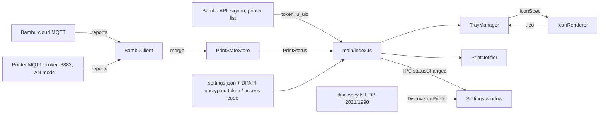

# Architecture

bambu-taskbar is an Electron app that lives in the tray. A settings window opens on demand.

## Files

| File | Role |
|---|---|
| `src/main/index.ts` | Start-up, settings window, IPC, starts and restarts the printer connection |
| `src/main/cloud/cloud_auth.ts` | Bambu account sign-in (password, email code, 2FA), user id, printer list. Pure; takes an `HttpClient` |
| `src/main/cloud/browser_signin.ts` | Sign-in window on Bambu's website (Google, Apple, email); picks up the `token` cookie |
| `src/main/cloud/electron_http.ts` | `HttpClient` built on Electron's Chromium network stack, with cookies |
| `src/main/printer/bambu_client.ts` | MQTT/TLS connection for both modes, reconnects, error classification, `pushall`, "printer off" hint |
| `src/main/printer/print_state.ts` | Merges reports (P1/A1 send deltas) and derives a `PrintStatus`. Pure, unit tested |
| `src/main/printer/printer_info.ts` | Stage names and model codes |
| `src/main/printer/discovery.ts` | Listens for printer announcements; `parseAnnouncement` is pure |
| `src/main/notifier.ts` | Turns state changes into notifications (finished, almost done, paused, failed, started) |
| `src/main/tray_manager.ts` | Tray icon, tooltip and menu text |
| `src/main/icon_renderer.ts` | Draws tray icons on a canvas in a hidden window; writes multi-size `.ico` files on Windows |
| `src/main/ico.ts` | Minimal `.ico` writer |
| `src/main/settings_manager.ts` | `settings.json`: validation, defaults, change events, which keys the window may edit |
| `src/main/secret.ts` | Encrypts the Bambu token and the LAN access code with Electron `safeStorage` (Windows DPAPI) |
| `src/main/taskbar_theme.ts` | Reads the taskbar's light/dark setting from the registry |
| `src/preload.ts` | The typed `window.trayApp` API for the settings window |
| `src/renderer/` | Settings window (HTML, CSS, TS) |
| `src/shared/types.ts` | Types shared by main, preload and renderer |

## Security

- Secrets never leave the main process. The settings window only learns whether a token or access code is
  saved (`cloudSignedIn`, `hasAccessCode`). The Bambu password goes straight from the form to the sign-in
  request and is never stored. Printer details change only through validated IPC calls.
- The settings window is sandboxed with context isolation. Links open in the default browser.
- TLS is always verified: Bambu's cloud broker against the system's trusted CAs, the printer (LAN) against
  Bambu Lab's CA and its serial number (see [protocol.md](protocol.md)).

## Tray icons

Same approach as razer-taskbar: Electron gives the Windows tray only the 1x bitmap of a `NativeImage`, which
looks blurry at 125% and 150% scaling, so on Windows the icon is written as a 16–48 px `.ico` and loaded by
path. Straight lines (the printer outline and the nozzle) are drawn on whole pixels. The ring, tick and cross are
anti-aliased.

| State | Percentage style | Ring style |
|---|---|---|
| Printing / preparing | number (max 99) | ring filled to the progress, with a nozzle laying a green line in the middle |
| Paused | amber number | amber ring + pause bars |
| Finished | green tick | green tick |
| Failed | red cross | red cross |
| Idle | printer outline | printer outline |
| Offline / not set up | faded printer outline | faded printer outline |

## Tests

`npm test` runs `node:test` suites through ts-node:

- `print_state.test.ts`: full and partial reports, string numbers, command replies, idle/finished/failed.
- `bambu_client.test.ts`: a fake printer (aedes MQTT broker over TLS with a certificate for the serial
  number) checks the connection, the `pushall` request, delta merging, a rejected access code, a wrong serial
  (certificate error) and an unreachable printer.
- `cloud_auth.test.ts`: a fake Bambu API covers password sign-in, the email-code flow (expired and wrong codes),
  two-factor with the CSRF and token cookies, the China region, Cloudflare blocks and the printer list.
- `bambu_client.test.ts` also runs cloud mode against a fake broker with a normal hostname certificate,
  including an expired token and the "printer off" hint.
- `browser_signin.test.ts`: which cookie counts as the sign-in token, and turning a website token into a session.
- `discovery.test.ts`, `notifier.test.ts`, `tray_text.test.ts`, `ico.test.ts`.
